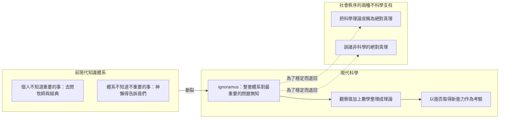
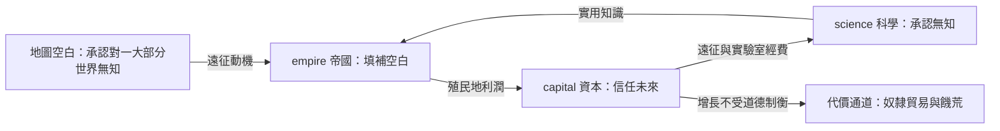
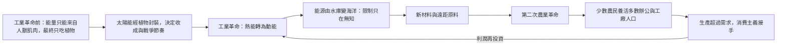
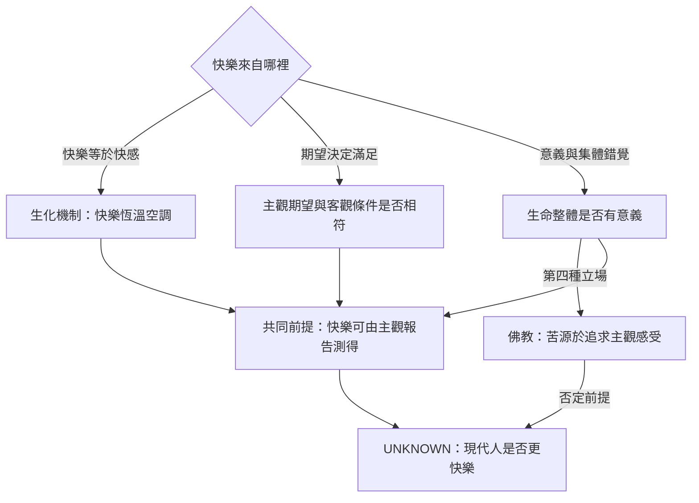
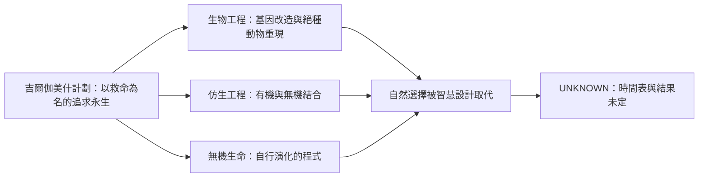

# 人類簡史 · 第四部分「科學革命」：知識來源

## 讀者與問題

- **讀者**：站長本人，以及任何不依賴聊天紀錄就要能重建這份知識的 Agent。
- **要回答的四個問題**：
  - **Q1 科學革命憑什麼突破前現代知識體系？**（認識論門檻）
  - **Q2 科學、帝國、資本如何互相供養？方向與條件是什麼？**（三位一體迴圈）
  - **Q3 能量與原料「有限」為何沒有讓經濟停下來？**（能量轉換與增長）
  - **Q4 能力暴增之後，快樂與「智人」本身發生了什麼事？**（快樂理論與智人末日）
- **不包含**：本書第一至三部分的主張；《未來簡史》《今日簡史》的內容；本專題其他歷史書。
- **專題邊界（2026-10-02 由使用者決定）**：`topics/大歷史/` 只處理**赫拉利三部曲**——《人類簡史》《未來簡史》《今日簡史》。
  《美國的故事》《押沙龍講世界史》《文明的故事（全11卷）》**本次不處理**，不產生任何主張、不建立知識檔、不改寫其 Topic README 條目。
- **《未來簡史》《今日簡史》狀態**：停在 `02_全書正文MD/人類簡史三部曲：重印版…/`。兩者**尚無可靠 bookId**（套裝來源 `44081364` 只是匯出來源，不是它們的知識對象），
  `03_` 內也**沒有任何 API 劃線**。依 repo 規則：不搜書城、不用書名猜 id；等使用者提供可靠 bookId 後，再各自建立**獨立**知識檔，不合成三部曲合集檔。

## 核心說明

第四部分把全書前三部分累積的「虛構故事」接到一台會自我增壓的機器上。

**第一道門檻是認識論的。** 前現代知識體系假設重要的事已經被神或智者寫進經典，因此只承認兩種無知：某個**個人**不知道重要的事（該去問牧師），或整個**體系**不知道某些**不重要**的事（神懶得說，所以不重要）。現代科學獨特之處，是公開承認「整套體系」對一些**最重要的**問題一無所知——赫拉利因此稱科學革命不是「知識的革命」，而是「無知的革命」。與之配套的是兩個方法：把經驗整理成觀察值與數學，以及用「能否取得新能力」而不是「是否真實」作為知識的考驗。

**第二道門檻是資源的。** 承認無知只給出動機，經費才給出路線。科學無力決定自己的優先順序：書中以「研究奶牛乳房炎（乳品業有影響力）與研究奶牛分離焦慮（動物團體有影響力）」的同一筆經費兩難為例，說明選擇標準出自政治、經濟與宗教利益，而非科學內部。更要緊的是，維繫社會秩序只能靠兩種「不科學」的方法——要嘛把某個科學理論宣稱為絕對真理（納粹的種族政策），要嘛訴諸非科學的絕對真理（自由人文主義的人權前提）。科學得倚靠宗教與意識形態才能取得經費並被正當化。

**第三道門檻是三者互鎖。** 科學提供實用知識給帝國，帝國回報資料、保護與經費；資本以信用與股份公司資助遠征和實驗室，帝國以殖民地利潤建立信任，科學以新技術與新能源擴大生產。這條迴圈的燃料是「承認無知 + 相信明天會更好」，而它的排氣口是書中不斷標記的代價：塔斯馬尼亞的滅族、孟加拉大饑荒、大西洋奴隸貿易、剛果橡膠、工業化畜牧。

**資源沒有上限，是因為「有限」只是無知的別名。** 工業革命前，能量轉換只能靠人獸自己的身體，而所有有機肌肉機器最終只吃植物，所以人類歷史由植物的生長週期與太陽的日夜季節主導。蒸汽機把熱能轉成動能之後，能源從「一座每年 3000 艾焦的水庫」變成「一片海洋」；新材料（鋁、塑膠、矽）與遠距運輸同時解決原料短缺。農業工業化釋放人力，工廠吸納，於是人類史上第一次生產超過需求——這就需要消費主義接手：有錢人的最高原則是「投資！」，其他人的最高原則是「購買！」。

**最後是兩個開著的問號。** 快樂有三種互不相容的解釋（生化機制、主觀期望相符、生命整體有意義），加上佛教的第四種（苦源於追求主觀感受本身）；而它們共同的前提「快樂可由主觀報告測量」本身就可疑，因此「現代人是否更快樂」在本章是明確的 UNKNOWN。與此平行，智人開始用生物工程、仿生工程與無機生命三條路徑取代自然選擇；書中把這一切的正當性來源追溯到吉爾伽美什計劃——「治療疾病、挽救性命」這個無人能反駁的標準答案。

## 來源

| ID | 路徑／定位 | 版本／查閱日期 | 適用範圍 |
| --- | --- | --- | --- |
| S1 | `LOCAL ONLY`：`topics/大歷史/02_全書正文MD/人類簡史三部曲：重印版（尤瓦爾·赫拉利作品）（套裝全3冊）/01_人類簡史：從動物到上帝（新版）.md`，第 2245–3818 行（第四部分起點至後記結束） | 本機檔案 2026-09-17；2026-10-02 查閱 | 本文件全部主張的正文依據；僅帶回結論與短引用，不重建正文 |
| S2 | `topics/大歷史/03_精華劃線與書評摘要/人類簡史：從動物到上帝_精華與書評.md`，bookId `855812`，`exportedAt: 2026-09-16 22:41:42` | WeRead API 匯出 2026-09-16 | 讀者共鳴金句與深度書評；第四部分範圍內僅 3 則熱門劃線（第16章、第19章、後記） |
| S3 | control plane `workflows/knowledge-publication/SKILL.md` | GitHub 預設分支（本機 clone 2026-10-02 查閱） | 產出流程與驗證規則，**不是**事實來源 |
| S4 | Flash UI Craft locator：`arislee1979-afk/0_YT_TEST` @ `9ffd9f31c104fa09b44f9bd87c25cbf01313b432` | 2026-10-02 核對；本機 clone HEAD 即此 commit | HTML 視覺層資產與檢查工具 |

> S1 位於 Git ignored 的 `02_`。本檔只保存從 S1 核對回來的結論與短引用，以及 S2 的 API 資料，不構成第二份全文語料庫。

## 主張與未知

| ID | 主張 | 狀態 | 依據 |
| --- | --- | --- | --- |
| C1 | 現代科學有三個特徵：願意承認自己的無知、以觀察和數學為中心、取得新能力 | FACT | S1 2293–2301 |
| C2 | 前現代體系只承認兩種無知：個人不知道重要的事（去問智者）、體系不知道不重要的事（神懶得告訴我們） | FACT | S1 2303–2309 |
| C3 | 科學革命是「無知的革命」，而非「知識的革命」 | FACT | S1 2301 |
| C4 | 維繫現代社會政治穩定只能靠兩種不科學的方法：宣稱科學理論是絕對真理（納粹種族政策），或訴諸非科學的絕對真理（自由人文主義） | FACT | S1 2321–2327 |
| C5 | 科學無力決定自身優先順序與成果用途；經費流向由政治、經濟、宗教利益決定（奶牛乳房炎 vs 奶牛分離焦慮兩難） | FACT | S1 2524–2532 |
| C6 | 科學與帝國共享「承認無知 → 前往尋找 → 成為世界主人」的心態；庫克遠征同時是科學遠征與武力遠征，並為塔斯馬尼亞原住民帶來滅族 | FACT | S1 2543–2561 |
| C7 | 歐洲的優勢不在 1850 年前的科技差距，而在現代早期累積的兩種潛力：現代科學與資本主義 | FACT | S1 2578–2588 |
| C8 | 帝國以「進步」為科學正名；種族主義的位置後來由「文化主義」取代 | FACT | S1 2760, 2782–2793 |
| C9 | 現代經濟的核心詞是「增長」；銀行放款約為庫存的十倍，整個體系建立在對未來的信任上 | FACT | S1 2809–2841 |
| C10 | 資本主義教條第一條：生產的利潤必須再投資於提高產量；資本與財富的區分在於是否投入生產 | FACT | S1 2888–2890 |
| C11 | 資本與消費主義是一體兩面：有錢人的最高原則是「投資！」，其他人的最高原則是「購買！」 | FACT | S1 3205–3207 |
| C12 | 工業革命的核心是能源轉換革命；能源與原料的限制只在無知（太陽 90 分鐘送到地球的能量即等於人類一年用量） | FACT | S1 3094–3096, 3115–3120 |
| C13 | 農業工業化是第二次農業革命，它釋放人力給工廠與辦公室，才使工業革命有可能 | FACT | S1 3142, 3174 |
| C14 | 快樂有三種主要解釋：生化機制（快樂恆溫空調）、主觀期望與客觀條件相符、生命整體有意義（可能是集體錯覺）；佛教另主張苦源於追求主觀感受本身 | FACT | S1 3520–3606 |
| C15 | 智人取代自然選擇有三條路徑：生物工程、仿生工程、無機生命；其正當性旗艦是吉爾伽美什計劃 | FACT | S1 3645, 3797 |
| C16 | 團體能力的提升不保證個體福祉；本書後記以此總結全書 | FACT | S1 3808–3816 |
| I1 | 三位一體是相互強化的迴圈，而非單向因果鏈；書中個別案例的因果強度未量化 | INFERENCE | 推導：S1 2280、2534、2908 反覆以「迴圈」「引擎」描述，但未給權重 |
| I2 | 「庫克遠征的科學／軍事雙重性」是本專題最適合的關係圖範本，因為它同時落在同一條主張的不同側面 | INFERENCE | 推導：S1 2561 自問「是有武力保護的科學遠征隊，還是有幾個科學家同行的武力遠征軍」 |
| U1 | 現代人是否比中世紀或採集者更快樂 | UNKNOWN | S1 3614–3616 明言討論才剛起步；S2 未提供快樂相關劃線 |
| U2 | 生物工程／仿生工程／無機生命的時間表與最終結果 | UNKNOWN | S1 3789–3791 明言預測不可能樣樣準 |
| U3 | 最佳經濟模式為何 | UNKNOWN | S1 2315 明言每次危機後主流就改變，目前仍不知道 |
| U4 | S2 記載的「最後閱讀章節：第 28 章」與本書 20 章的結構不符，判定為匯出端產物，不可作為引用依據 | UNKNOWN | S2 `progress: 94%`、`最後閱讀章節` 欄位 |

### S2 在第四部分範圍內的讀者共鳴（熱門劃線）

第四部分跨度（第 14–20 章＋後記）只有 3 則 API 熱門劃線，全部列出：

| 章節 | 短引用 | 讀者劃線數 |
| --- | --- | --- |
| 第十六章 資本主義教條 | 「真正讓銀行（以及整個經濟）得以存活甚至大發利市的，其實是我們對未來的信任。」 | 14,580 |
| 第十九章 從此過著幸福快樂的日子 | 「只要有了活下去的理由，幾乎什麼都能夠忍受。」（書中引尼采） | 16,783 |
| 後記 變成神的這種動物 | 「擁有神的能力，但是不負責任、貪得無厭，而且連想要什麼都不知道。」 | 21,131 |

> 邊界說明：以上為 WeRead API 直接提供的熱門劃線，屬本專案刻意保存的精華資料。其餘內容是我從 S1 核對後的原創綜合，未摘錄正文段落。

## 節點

| ID | 名稱 | 角色 | 主張／來源 |
| --- | --- | --- | --- |
| ignoramus | 承認無知 | 認識論門檻：體系公開承認自己對最重要的問題無知 | C1、C3 |
| mathobs | 觀察與數學 | 方法：把經驗整理成可計算的理論 | C1 |
| newpower | 新能力 | 考驗：能造出新東西的才算知識 | C1 |
| science | 科學 | 承認無知並前往尋找的知識體系 | C1、C5、C6 |
| empire | 帝國 | 填補地圖空白、取得資料與保護的遠征者 | C6、C7、C8 |
| capital | 資本 | 相信明天會更好、以信用與再投資增壓的經濟 | C9、C10、C11 |
| credit | 信用 | 把想象未來的資源拿到現在用的機制 | C9 |
| growth | 增長 | 現代經濟的主目標與資本主義教條的核心 | C9、C10 |
| energy | 能源轉換 | 工業革命的真正核心 | C12 |
| agri | 農業工業化 | 釋放人力給工廠與辦公室的第二次農業革命 | C13 |
| consume | 消費主義 | 接手「生產超過需求」的新倫理 | C11 |
| happiness | 快樂 | 三種互不相容的解釋與未決前提 | C14、U1 |
| sapiens | 智人 | 開始以智慧設計取代自然選擇的物種 | C15、U2 |
| cost | 代價通道 | 迴圈的排氣口：奴隸貿易、饑荒、滅族、工業化畜牧 | C6、C8、C13 |

## 關係

| 起點 | 關係 | 終點 | 條件／依據 |
| --- | --- | --- | --- |
| ignoramus | 推出 | mathobs | 只有承認不知道，才需要新的觀察（C1） |
| mathobs | 產出 | newpower | 數學理論的用途是取得新能力（C1） |
| newpower | 換取 | science | 新能力說服政府與企業出錢，形成回饋（I1、S1 2280） |
| science | 提供實用知識給 | empire | 地圖、醫藥、語言學具政治軍事價值（C6） |
| empire | 回報資料與保護給 | science | 遠征隊攜帶科學家，帝國資助研究（C6） |
| empire | 供給殖民地利潤給 | capital | 美洲金銀與種植園建立信任（C9） |
| capital | 資助遠征與實驗室 | empire | 信用讓征服不必靠加稅（C9） |
| capital | 投資科學研究 | science | 金主先問「會提高產量和利潤嗎」（C5、S1 2906） |
| science | 提供技術與新能源給 | capital | 印鈔票的是銀行，買單的是科學（C11、S1 2908） |
| growth | 需要原材料與能源 | energy | 若能源耗盡系統就崩潰（C12） |
| energy | 解除原料限制 | agri | 廉價能源讓遠距原料與新材料可行（C12） |
| agri | 釋放人力給 | consume | 少數農民養活多數非農業人口，生產超過需求（C11、C13） |
| consume | 產生更多利潤回流 | growth | 「購買！」與「投資！」互為條件（C11） |
| growth | 排氣出 | cost | 增長不受道德制衡時衍生成災難（C8） |
| happiness | 前提被質疑 | sapiens | 若能改造慾望，快樂問題與人的定義同時被改寫（C14、C15） |
| sapiens | 三條路徑取代 | newpower | 自然選擇被智慧設計取代（C15） |

## 圖表

Mermaid 是 canonical 的圖語法；HTML 呈現層以原生 SVG 重建，並保留同一組節點 ID。

### D1 科學革命的認識論門檻（回答 Q1）

### D2 科學、帝國、資本的三位一體迴圈（回答 Q2）

> D2 只畫三節點的迴圈主幹。關係表列出全部 8 條配對關係（含帝國回報資料給科學、資本投資科學研究、科學提供技術與新能源給資本）；圖不重畫第二圈，避免把「互相強化」畫成網狀雜訊。

### D3 能源、原料與增長（回答 Q3）

### D4 快樂的三種解釋與未決前提（回答 Q4）

### D5 智人末日的三條路徑（回答 Q4 的另一半）

## 限制與下一步

- **對照來源**：另一份 canonical `人類簡史第四部分_雙源比對與整合_知識來源.md` 把本檔（C1–C16，書籍正文）與
  `LOCAL ONLY` 的 `0_YT_TEST/topics/02_human-history/` a00–a06 影片筆記交叉比對。
  結論：C1–C10 有雙源覆蓋，**C11–C15 只有書籍正文**（影片筆記未涵蓋第 17–20 章與後記）；
  影片筆記另有一批當代遺產主張（C17–C24），全部標 INFERENCE，並已查出數字錯置等 8 項衝突（X1–X8）。
  凡引用當代遺產或外部數字，一律以該比對檔為準，不要直接引用影片筆記。
- **內容邊界**：本檔不得變成第二份全文語料庫。S1 是 Git ignored 的本機語料；引用僅限結論與單句短引用。
- **專題範圍（已決定，不再擴大）**：只做赫拉利三部曲；其中《人類簡史》目前只完成第四部分這一層，其他部分未做，也**不主動擴写**。
- **未解矛盾**：U1、U2、U3 都沒有答案，也不该在呈現層被畫成已解決。D4 的 UNKNOWN 出口必須保留。
- **《未來簡史》《今日簡史》等 bookId**：兩者停在 `02_`，不建獨立 `03_` 知識檔、不跑 `generate_book_highlights.py`／`export_topic.py`。
  使用者提供可靠 bookId 後，再各自建立獨立知識檔（不合成三部曲合集檔），並以同一組節點 ID 接上「資料取代故事」這條關係，避免同名異義的節點。
- **本專題其他歷史書不處理**：《美國的故事》《押沙龍講世界史》《文明的故事（全11卷）》保持 `LOCAL ONLY` 現狀，不寫入、不改 Topic README 條目。
- **待人工決策**：是否把本檔的 HTML 呈現層納入 Git 追蹤；本倉庫現在的活分支是 `main`，本次不做任何提交或推送。
