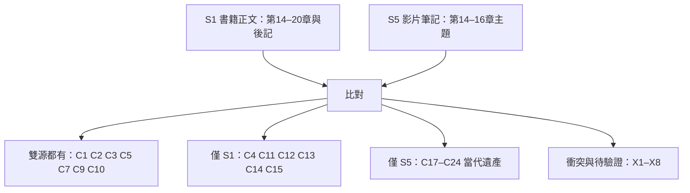

# 人類簡史 第四部分：雙源比對與整合

## 目的與兩個來源家族

| 家族 | 內容 | 定位 |
| --- | --- | --- |
| **書籍正文** | S1《人類簡史》第四部分本機全文（Git ignored）；S2 WeRead API 劃線 | 主張主體，`C1–C16` 全部 FACT 可回溯行號 |
| **影片解析筆記** | S5 `0_YT_TEST/topics/02_human-history/` a00–a06 | 深度補充 Ch.14–16 細節，並把論點延伸到 21 世紀遺產；**多數數字未標來源** |

整合原則：S1 是可定位的書籍正文，S5 是二手轉述。凡 S1 與 S5 都有的主張，以 S1 行號為準；凡只有 S5 有的，一律標 **INFERENCE** 並註明「S5 引用外部文獻，書籍正文未述」——不因為兩邊都講就升格成 FACT。

## 來源

| ID | 路徑／定位 | 版本／查閱日期 | 適用範圍與限制 |
| --- | --- | --- | --- |
| S1 | `LOCAL ONLY`：`22_WeRead/topics/大歷史/02_全書正文MD/人類簡史三部曲：重印版…/01_人類簡史：從動物到上帝（新版）.md` 第 2245–3818 行 | 2026-10-02 查閱 | C1–C16 的正文依據 |
| S2 | `…/03_精華劃線與書評摘要/人類簡史：從動物到上帝_精華與書評.md` | WeRead API 2026-09-16 | 讀者共鳴金句 |
| S5 | `LOCAL ONLY`：`0_YT_TEST/topics/02_human-history/` 七檔（a00 總表、a01 科學與帝國的聯姻、a02 承認無知與空白地圖、a03 科學帝國與資本主義的莫比烏斯環、a04 非中立的科學與製圖術、a05 無知之發現、a06 總結） | 2026-10-02 查閱 | 補充細節與當代遺產；**五支影片僅一支有可驗證 URL** |

### S5 的來源可信度限制（必讀）

- **可驗證 URL 僅 1 支**：a01／a05 引用 `https://www.youtube.com/watch?v=kWgilD98VyA`（Last Minute Lecture）。其餘四支（Sanchit Arvind & Rich Hebron、深度說書精讀頻道、書籍章節導讀系列等）只給 YouTube 搜尋連結；「深度說書精讀頻道」「書籍章節導讀系列」非可識別頻道名。
- **譯名不一致**：a00 第 3 行與 a06 把書名寫作《人類大歷史：從野獸到扮演上帝》卻括注 *Sapiens: A Brief History of Humankind*；中文副標題與英文原題不符。
- **多數數字無來源**：a01–a06 的具體數字（死亡人數、比例、船隊規模）幾乎都沒有標註出處。
- 因此本檔對 S5 只做「有跡可查的補充」，不做事實背書。

## 雙源覆蓋圖（D6）

> 讀法：左邊兩條來源的粗細不同——S1 覆蓋整部第四部分，S5 只到第 16 章主題。兩個家族是**互補**，不是重複。

## 覆蓋矩陣（C1–C16 × S5）

| ID | 主張（簡） | S1 | S5 | 判定 |
| --- | --- | --- | --- | --- |
| C1 | 現代科學三特徵 | ✅ | a05 | 雙源一致 |
| C2 | 前現代兩種無知 | ✅ | a05「要嘛微不足道…要嘛神明隱秘」 | 雙源一致 |
| C3 | 無知的革命 | ✅ | a05「奠基口號不是…而是我們不知道」 | 雙源一致 |
| C4 | 維繫穩定的兩種不科學方法 | ✅ | **缺** | 僅 S1 |
| C5 | 經費由政治經濟宗教決定 | ✅ | a04「資金流向決定了真理的邊界」 | 雙源一致，S5 補強 |
| C6 | 科學×帝國心態、庫克、塔斯馬尼亞 | ✅ | a01（奮進號 1768、Truganini 1876） | S5 補充年份細節 |
| C7 | 現代早期累積的潛力 | ✅ | a02「1750 年並無絕對優勢」 | 雙源一致，S5 補數字 |
| C8 | 進步正當化、種族主義→文化主義 | ✅ | a01「科學種族主義、白人的負擔」 | S5 部分對應（缺「進步論證」與「文化主義取代」） |
| C9 | 增長＋對未來的信任 | ✅ | a03「相信明天會比今天更有錢」 | 雙源一致 |
| C10 | 利潤再投資 | ✅ | a03「將利潤與再投資掛鉤」 | 雙源一致 |
| C11 | 資本與消費主義一體兩面 | ✅ | **缺** | 僅 S1 |
| C12 | 工業革命＝能源轉換 | ✅ | **缺** | 僅 S1 |
| C13 | 第二次農業革命、人力釋放 | ✅ | **缺** | 僅 S1 |
| C14 | 快樂三解釋＋佛教 | ✅ | **缺** | 僅 S1 |
| C15 | 生物/仿生/無機生命、吉爾伽美什 | ✅ | a05 僅把基因編輯當狂妄例證 | 僅 S1（S5 不相當） |
| C16 | 團體能力≠個體福祉 | ✅ | a05「全球貧富與力量鴻溝就拉大一次」 | S5 部分對應 |

**結論**：C1–C10 有雙源覆蓋；**C11–C15 只有書籍正文**。S5 的實戰範圍是第 14–16 章主題（承認無知、科學與帝國、資本主義開端），第 17–20 章與後記（工業革命、快樂、智人末日）在影片筆記中沒有對應內容。

## S5 獨有主張（C17–C24，全部 INFERENCE）

書籍正文未述，由 S5 引用外部文獻而來。全部標 INFERENCE，不使用 FACT。

| ID | 主張 | 來源 | 依據 |
| --- | --- | --- | --- |
| C17 | 塔斯馬尼亞與澳洲殖民的具體年代：1803 英國人抵達時原住民約「數千名」、1820–30 Black War、Truganini 1876 年卒且遺體被掘出展出數十年 | S5-a01 | INFERENCE：S5 未標來源 |
| C18 | 澳洲「失竊的一代」：20 世紀初至 1970 年代約 10 萬名原住民兒童被強制遷離；原住民預期壽命短約 8–10 年、監禁率高 15 倍以上；2023 年「原住民之聲」公投否決 | S5-a01 | INFERENCE：S5 未標來源 |
| C19 | 帝國直線劃界的當代後果：1884–85 柏林會議 14 國劃定數萬公里直線邊界；1916 賽克斯-皮科協定（阿卡—基爾庫克線）塑造敘利亞／伊拉克／黎巴嫩 | S5-a02 | INFERENCE：S5 未標來源 |
| C20 | 製圖與投影的認知效應：非洲面積約為格陵蘭 14 倍；第三世界逾 60% 國界由歐洲人劃下；麥卡托投影放大高緯度 | S5-a02 | INFERENCE：S5 未標來源 |
| C21 | 科學作為殖民行政工具：1802 年起大三角測量、1876 年 Wickham 從邱園走私 70,000 顆橡膠種子致巴西橡膠崩潰、1786 年瓊斯提印歐語系後被接上雅利安神話 | S5-a04（引 Brockway、Edney） | INFERENCE：S5 引用外部文獻，書籍正文未述 |
| C22 | 身份政治的制度化：1871 年起印度「科學人口普查」與分開選舉制被連結到 1947 年印巴分治；1930 年代比利時在盧安達以身份證量化圖西／胡圖，被連結到 1994 年約 80 萬人百日屠殺 | S5-a04／S5-a02 | INFERENCE：因果鏈由 S5 建立，書籍正文未建立 |
| C23 | 金融掠奪的具體數字：1621 年班達群島約 15,000 人被屠殺或為奴、生者不足千人；1781 年宗號船 130 餘名黑奴被拋海詐保；1765 年東印度公司取得孟加拉 Diwani、年分紅 10–12.5%、土地稅高達 50%；1769–70 年孟加拉大饑荒約 1,000 萬人死 | S5-a03 | INFERENCE：數字均無來源 |
| C24 | 當代遺產與去殖民化主張：專利與條約牆（TRIPS、ISDS、印楝樹專利、疫苗分配不平等）；IMF／世界銀行的結構性調整與主權債務依附；AI／LLM 時代的「演算法殖民」；以及去殖民化三段（認識論、技術作為全球公共財、歷史正義修復） | S5-a03／a04／a05／a06（引 Shiva、Wallerstein、赫拉利《21 世紀的 21 堂課》） | INFERENCE：去殖民化三段**非出於《人類簡史》**，是 S5 自身的政策主張 |

## 衝突、錯置與待驗證（X1–X8）

| ID | 項目 | 內容 | 判定 |
| --- | --- | --- | --- |
| X1 | **人口數字錯置** | a01 第 114 行在澳洲脈絡寫「原住民付出的代價是 90% 以上人口滅絕」；但 80–90% 是**美洲**數字（S1 2711、a02、a06 均用於美洲） | **不採用 a01 的澳洲版本**；澳洲框架下只用 C17／C18 的年代與制度事實 |
| X2 | **覆蓋範圍落差** | S5 無 C11–C15 對應內容，即第 17–20 章與後記沒有影片筆記；a00 的影片清單中影片 03 對應第 16 章 | 記錄為覆蓋缺口；引用 S5 時不得宣稱它涵蓋整部第四部分 |
| X3 | **孟加拉內部張力** | C23 中「約 1,000 萬人死＝孟加拉人口三分之一」隱含當時約 3,000 萬人，與同檔「土地稅高達 50%」互為張力，S5 未討論 | **UNKNOWN**：兩個數字分開保留，不互相推導 |
| X4 | **譯名不符** | S5 副標題《從野獸到扮演上帝》與 *Sapiens: A Brief History of Humankind* 不符 | 來源表已標示；引用書名以 S1／S2 為準 |
| X5 | **來源可驗證性** | 五支影片僅一支有 URL | 限制已聲明；S5 的主張不得升格為 FACT |
| X6 | **不可查證數字** | a03「哥倫布資本回報率高達數萬倍」無可查證基礎 | **UNKNOWN**，不進入任何主張卡 |
| X7 | **鄭和規模兩種表述** | a02 給絕對量（寶船 100 餘米、28,000 人）；a01 給相對量（「規模遠超庫克數十倍」）。兩者不可相加 | 兩種表述並列，選用時註明是哪一種 |
| X8 | **剛果數字單邊** | S1（3048 行）載 1885–1908 年剛果約 600 萬人喪生（至少佔兩成，有估計達千萬）；S5 全系列未提及剛果 | 單邊來源：記入 S1，不視為雙源共識 |

## 單邊數字（不可當共識）

雙方只有一邊提供的數字，一律不得在呈現層寫成「史料公認」：

- 僅 S1：孟加拉大饑荒 1,000 餘萬人（S1 2780）、美洲原住民銳減九成（S1 2711）、奴隸貿易約 1,000 萬人其中七成在甘蔗園（S1 3036）、剛果 600 萬（S1 3048）、太陽 90 分鐘能量等於人類一年用量（S1 3117）
- 僅 S5：班達 15,000（C23）、失竊的一代 10 萬（C18）、盧安達 80 萬（C22）、70,000 顆橡膠種子（C21）、1900 年歐洲掌控近 85% 陸地（C7 補充）

## 整合後的新節點與關係

沿用基礎來源的節點 ID，只新增四個：

| ID | 名稱 | 角色 | 主張／來源 |
| --- | --- | --- | --- |
| legacy | 當代遺產 | S5 延伸到 21 世紀的制度性後果 | C19、C20、C22、C24 |
| cartography | 製圖術 | 科學作為行政與認知工具 | C20、C21 |
| creditwar | 金融掠奪 | 信貸、股份公司與戰爭的商品化 | C23 |
| decolonization | 去殖民化 | S5 自身提出的三段改革主張 | C24 |

| 起點 | 關係 | 終點 | 條件／依據 |
| --- | --- | --- | --- |
| empire | 遺留給 | legacy | 直線國界與身份政治制度化的長期後果（C19、C22） |
| science | 被用作 | cartography | 測量、普查、植物轉移都是行政工具（C20、C21） |
| capital | 具體化為 | creditwar | 保險、股份、武力討債（C23） |
| legacy | 待人類決策 | decolonization | 去殖民化三段是 S5 的主張，不是書籍結論（C24） |
| cartography | 反向強化 | empire | 地圖空白既是科學產品也是佔領依據（I2） |

## 限制與下一步

- **S5 永遠是 INFERENCE 層**：除非另行取得可引用的原始出處（書頁、論文、可驗證影片），C17–C24 不升格為 FACT。
- **X1 是這輪比對最重要的產出**：它證明兩個來源並列時必須逐条對照脈絡，不能因為數字大、語氣強就照抄。
- **待人工決策**：C24 的去殖民化三段是有立場的政策主張，是否要在呈現層保留、以何種標籤呈現。
- **下一輪**：若要補 S5 缺的 C11–C15，應從書籍正文（S1 第 17–20 章與後記）擴充，而不是再找影片。
